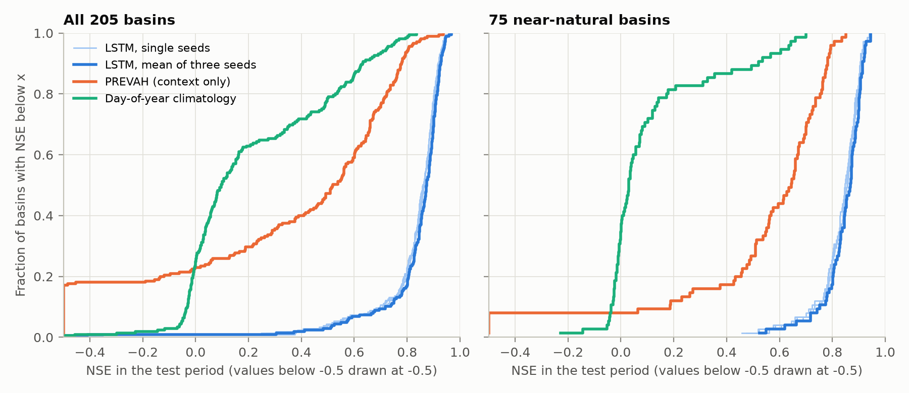
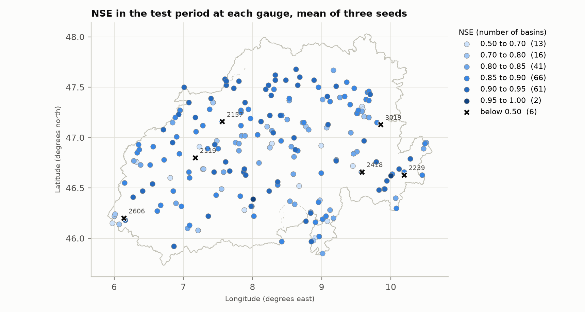
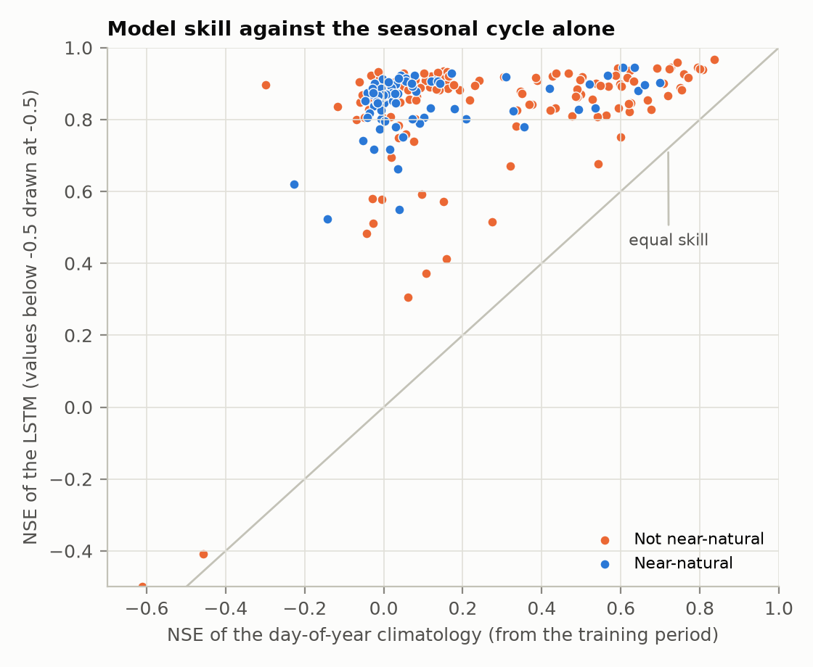
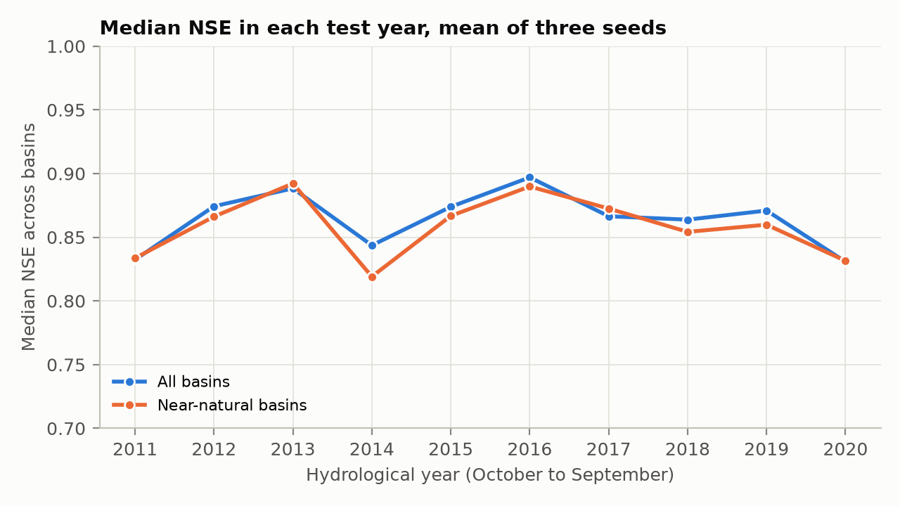
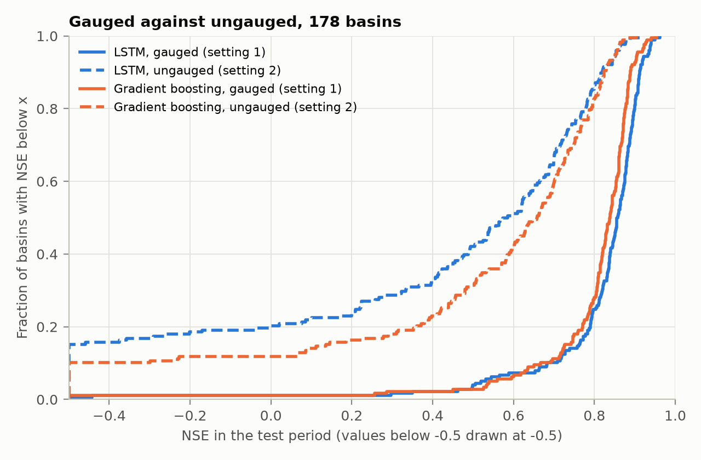
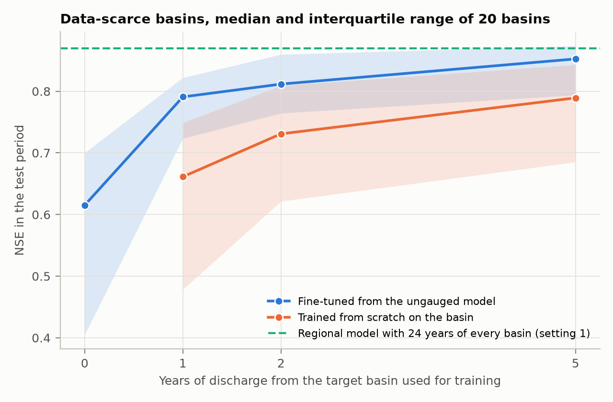

# Multi-basin streamflow modelling on CAMELS-CH

**Status: settings 1, 2 and 3 and the gradient-boosting comparison are run, verified and
audited. The sensitivity run with the simulation-based forcing is not done.** Every number below is
generated from saved predictions by `scripts/make_report.py`, after an independent
recomputation of the metrics. See [RESULTS.md](RESULTS.md) and [AUDIT.md](AUDIT.md).

## Question

How well does a single regional LSTM, trained on many catchments of hydrologic
Switzerland at once, predict daily streamflow in three settings?

1. Unseen period in gauged basins.
2. Ungauged basins (k-fold cross-validation over basins).
3. Data-scarce basins (pre-train on other basins, fine-tune with 1, 2 and 5 years).

Gradient-boosted trees on hand-made forcing features serve as a second data-driven model
in settings 1 and 2.

## Data

CAMELS-CH (Höge et al., 2023, ESSD 15, 5755-5784), version 0.9 from Zenodo
(concept DOI [10.5281/zenodo.7784632](https://doi.org/10.5281/zenodo.7784632), CC-BY-4.0).
The dataset is not redistributed here. `scripts/download_data.py` downloads it and
checks the MD5 sums published by Zenodo.

- Target: observed specific discharge, `discharge_spec` (mm/d), daily.
- Forcing: MeteoSwiss observation-based grids shipped with CAMELS-CH (precipitation,
  minimum, mean and maximum temperature, relative sunshine duration).
- The forcing in the dataset's `simulation_based` folder is not used for the main runs.
  A design audit found that this product changes on 2010-01-01 (mean wind +65 %, PET
  +19 %, different daily precipitation window), which falls between the training and
  the test period. A sensitivity run with it is configured (`configs/sensitivity_simforcing_seed1.yml`) and was not run. PREVAH model output (simulated
  discharge, ET, interception) is never used as input.
- Static attributes: 45 attributes from topography, land cover, geology, soil, glacier
  cover, population density, and eight climate indices recomputed from training-period
  forcing (the indices shipped with the dataset cover 1981-2020, which includes the test
  period). The hydrological signature tables are excluded because they are computed from
  streamflow. Hydropower and reservoir attributes are not inputs because they are only
  populated inside Switzerland; they are used to flag basins. See `results/data_report/`.

### Basin selection

Of 331 catchments, 205 are used (175 CH, 14 AT, 13 FR, 2 DE, 1 IT). Excluded:

| Reason | Basins |
|---|---|
| Observation-based forcing incomplete (catchments outside the MeteoSwiss grids) | 53 |
| Lake (dataset readme) | 33 |
| Fewer than 5 years of valid discharge in the training period | 26 |
| Fewer than 2 years of valid discharge in the validation period | 3 |
| Fewer than 3 years of valid discharge in the test period | 2 |
| Discharge more than twice precipitation in the training period | 3 |
| Dataset readme recommendation (2446, 2447, 2327) | 3 |
| Duplicated or identical discharge series (2613, 4008, 4009) | 3 |

The per-basin table with quality-control columns is `results/data_report/basin_report.csv`.
`results/data_report/basin_flags.csv` flags regulated (81), major reservoir (48),
glacierised (32), lake-influenced (34), open water balance (18) and basins outside
Switzerland with unknown human influence (30). 75 basins carry no flag. Results will be
reported for all basins and for the unflagged subset.

### Periods (hydrological years)

| Period | From | To |
|---|---|---|
| Train | 1981-10-01 | 2005-09-30 |
| Validation | 2005-10-01 | 2010-09-30 |
| Test | 2010-10-01 | 2020-09-30 |

Split files live in `splits/` with SHA-256 sums and are checked by `tests/test_leakage.py`.

## Models

One LSTM for all basins (NeuralHydrology, `cudalstm`), with the configuration of Kratzert
et al. (2019). Hidden size 256, input sequence of 365 days, NSE loss, 30 epochs, learning
rate lowered at epochs 10 and 25, output dropout 0.4. Inputs are the five forcing variables
and the 45 static attributes. No early stopping and no hyperparameter search. The last
epoch is evaluated once on the test period. Configurations are in `configs/`.

- Setting 1 trains on all 205 basins with three seeds.
- Setting 2 trains the same configuration once per fold on the training basins of that
  fold. The folds are in `splits/setting2/`: 178 basins below 2000 km2, grouped so that
  nested gauges stay in one fold.
- Setting 3 uses 20 basins (`splits/setting3/sample.csv`) and the last 1, 2 or 5 training
  years. It fine-tunes the setting-2 model of the fold in which the basin was held out,
  and trains a small LSTM from scratch on the same data for comparison
  (`scripts/make_setting3_configs.py`).
- Gradient boosting: XGBoost with fixed parameters, `scripts/gbm.py`.

Folds 0 to 2 of setting 2 and everything else ran on an RTX 3080. Folds 3 and 4 ran on
an RTX 3050 with the same code and package versions.

## Results

<!-- results:start -->
<!-- Generated by scripts/make_report.py. Do not edit by hand. -->

### Setting 1. Unseen period in gauged basins

One model is trained on all 205 basins with data from 1981-10-01 to 2005-09-30 and evaluated in the same
basins from 2010-10-01 to 2020-09-30. Three seeds, 30 epochs each, no early stopping, no hyperparameter search.
The last epoch is evaluated once on the test period. Metrics are computed per basin with simulated values below zero set
to zero, and then summarised across basins.

**All 205 basins**

| Model | Median NSE | NSE 5th-95th pct | Basins NSE < 0 | Median KGE | Median log-NSE | Median bias (%) | Median FHV (%) | Median FLV (%) |
|---|---:|---:|---:|---:|---:|---:|---:|---:|
| Seed 1 | 0.864 | 0.53 to 0.93 | 2 | 0.863 | 0.876 | -5.0 | -9.2 | -10.6 |
| Seed 2 | 0.860 | 0.55 to 0.93 | 2 | 0.849 | 0.876 | -6.1 | -10.7 | -9.0 |
| Seed 3 | 0.862 | 0.54 to 0.93 | 2 | 0.848 | 0.875 | -5.3 | -9.6 | +6.3 |
| Mean of the three seeds | 0.873 | 0.57 to 0.94 | 2 | 0.849 | 0.891 | -5.3 | -10.1 | +15.5 |
| Day-of-year climatology | 0.097 | -0.05 to 0.72 | 50 | 0.161 | 0.011 | +5.2 | n/a | n/a |
| PREVAH (context only) | 0.519 | -5.05 to 0.81 | 47 | 0.597 | 0.593 | +3.9 | n/a | n/a |

**75 near-natural basins** (no regulation, reservoir, glacier, lake, open water balance or unknown human influence flag)

| Model | Median NSE | NSE 5th-95th pct | Basins NSE < 0 | Median KGE | Median log-NSE | Median bias (%) | Median FHV (%) | Median FLV (%) |
|---|---:|---:|---:|---:|---:|---:|---:|---:|
| Seed 1 | 0.857 | 0.66 to 0.91 | 0 | 0.817 | 0.889 | -7.3 | -13.2 | -27.6 |
| Seed 2 | 0.848 | 0.65 to 0.92 | 0 | 0.825 | 0.879 | -7.2 | -12.3 | -35.0 |
| Seed 3 | 0.854 | 0.68 to 0.91 | 0 | 0.815 | 0.890 | -7.9 | -13.8 | -6.5 |
| Mean of the three seeds | 0.868 | 0.70 to 0.92 | 0 | 0.818 | 0.901 | -7.5 | -13.4 | +4.1 |
| Day-of-year climatology | 0.030 | -0.04 to 0.61 | 26 | 0.000 | -0.160 | +7.0 | n/a | n/a |
| PREVAH (context only) | 0.645 | -1.09 to 0.79 | 6 | 0.621 | 0.724 | -0.3 | n/a | n/a |

NSE and KGE are 1 for a perfect simulation. FHV is the bias of the highest 2 % of flows and FLV the bias of the lowest
30 % in log space (Yilmaz et al., 2008). The climatology is the mean observed flow of each calendar day in the training
period. PREVAH is the calibrated process-based simulation shipped with CAMELS-CH. Its calibration may have used the
test period and its forcing changes on 2010-01-01, so it is shown for context and not as a competitor.





**What the numbers say**

- A single model reaches a median NSE of 0.86 (seeds from 0.860 to 0.864). Averaging the three
  simulations gives 0.873. The first number describes one model and the second an ensemble of three.
- The near-natural subset has a median of 0.868, the remaining basins 0.883. Human influence does not
  lower the median, but it accounts for every poor basin. All 6 basins with NSE below 0.5 are regulated or
  have an open water balance, and the lowest NSE among near-natural basins is 0.52.
- 2 basins have a negative NSE. Both are described under failures below.
- High flows are underestimated. The median FHV is -10 % for all basins and -13 % for near-natural
  basins, and the simulated variability is 0.89 of the observed one in the median basin.
- Total volume is underestimated by a median of 5.3 % (7.5 % in near-natural basins).
- Small basins are harder. Basins below 50 km2 have a median NSE of 0.81, basins between 200 and 1000 km2
  0.89.
- FLV is not a usable summary here. Between 20 and 32 basins per seed have observed or simulated
  flows near zero in the low-flow segment, where the log bias takes values of several thousand percent. The median
  log-NSE of 0.891 is the more reliable low-flow number.

**Is the skill only the seasonal cycle?**

Many of these basins are fed by snow and ice and have a regular annual cycle that a model can reproduce without
predicting anything. The table compares the model with the day-of-year climatology of each basin. The skill over
climatology is 1 minus the ratio of the squared errors of the model and of the climatology.

| Group | Basins | Median NSE | 25th pct NSE | Lowest NSE | Median NSE of climatology | Median skill over climatology |
|---|---:|---:|---:|---:|---:|---:|
| All basins | 205 | 0.873 | 0.83 | -1.66 | 0.10 | 0.83 |
| Near-natural | 75 | 0.868 | 0.82 | 0.52 | 0.03 | 0.85 |
| Not near-natural | 130 | 0.883 | 0.83 | -1.66 | 0.16 | 0.81 |
| Regulated | 81 | 0.888 | 0.83 | -0.41 | 0.24 | 0.81 |
| Major reservoir | 48 | 0.855 | 0.79 | -0.41 | 0.36 | 0.72 |
| Lake-influenced | 34 | 0.903 | 0.86 | 0.41 | 0.15 | 0.86 |
| Open water balance | 18 | 0.805 | 0.58 | -1.66 | 0.07 | 0.59 |
| Outside Switzerland (human influence unknown) | 30 | 0.856 | 0.80 | 0.37 | 0.08 | 0.77 |
| No glacier | 105 | 0.863 | 0.81 | -1.66 | 0.03 | 0.86 |
| Glacier cover > 5 % | 32 | 0.900 | 0.84 | 0.41 | 0.65 | 0.69 |
| Glacier cover > 20 % | 10 | 0.885 | 0.85 | 0.68 | 0.75 | 0.57 |
| Snow fraction < 0.1 | 51 | 0.872 | 0.82 | -1.66 | 0.00 | 0.87 |
| Snow fraction > 0.5 | 15 | 0.883 | 0.84 | 0.68 | 0.69 | 0.64 |
| Mean elevation < 700 m | 22 | 0.887 | 0.75 | -1.66 | 0.01 | 0.89 |
| Mean elevation 700-1200 m | 74 | 0.873 | 0.85 | 0.51 | 0.02 | 0.87 |
| Mean elevation 1200-1800 m | 50 | 0.880 | 0.80 | 0.41 | 0.17 | 0.81 |
| Mean elevation 1800-2400 m | 47 | 0.854 | 0.82 | -0.41 | 0.54 | 0.70 |
| Mean elevation > 2400 m | 12 | 0.892 | 0.86 | 0.68 | 0.72 | 0.68 |
| Area < 50 km2 | 40 | 0.807 | 0.75 | -1.66 | 0.02 | 0.75 |
| Area 50-200 km2 | 58 | 0.873 | 0.85 | 0.51 | 0.09 | 0.84 |
| Area 200-1000 km2 | 62 | 0.893 | 0.85 | -0.41 | 0.07 | 0.86 |
| Area > 1000 km2 | 45 | 0.895 | 0.83 | 0.41 | 0.32 | 0.83 |

Across all basins the median skill over climatology is 0.83 and the median NSE of the anomalies from the seasonal
cycle is 0.83. In basins without glacier the climatology has no skill (median NSE 0.03)
and the model NSE of 0.86 is all predictive. In basins with more than 20 % glacier cover the climatology
alone reaches 0.75, and the model improves on it by
0.57 of the remaining error. A high NSE in a glacier basin means
less than the same NSE in a lowland basin.



**Stability over the test years**

| Hydrological year | Basins | Median NSE | Median NSE, basins with all years | Mean NSE | Mean NSE without basin 2239 |
|---:|---:|---:|---:|---:|---:|
| 2011 | 204 | 0.832 | 0.834 | 0.76 | 0.77 |
| 2012 | 203 | 0.874 | 0.875 | 0.82 | 0.82 |
| 2013 | 204 | 0.888 | 0.889 | 0.84 | 0.84 |
| 2014 | 205 | 0.844 | 0.851 | 0.79 | 0.79 |
| 2015 | 204 | 0.874 | 0.878 | 0.83 | 0.83 |
| 2016 | 204 | 0.897 | 0.903 | 0.86 | 0.87 |
| 2017 | 197 | 0.866 | 0.874 | -0.40 | 0.80 |
| 2018 | 188 | 0.864 | 0.863 | -2.53 | 0.81 |
| 2019 | 171 | 0.871 | 0.871 | -5.26 | 0.81 |
| 2020 | 172 | 0.831 | 0.830 | -2.30 | 0.73 |

The median stays between 0.83 and 0.90. The mean is not usable. Basin 2239 has an almost
constant observed flow from 2017 on, which gives yearly NSE values between -1038 and
-234 and pulls the mean of all basins below zero. 33 records, most of them outside Switzerland,
end before the test period does. Restricting the table to the 171 basins with all years changes the yearly
median by at most 0.008.



**Failures**

| Basin | Gauge | River | Area (km2) | Flags | NSE | r | Variability ratio | Mean ratio | Q/P train | Q/P test |
|---:|---|---|---:|---|---:|---:|---:|---:|---:|---:|
| 2157 | Gerlafingen | Strackbach | 13 | water balance open | -1.66 | 0.47 | 0.84 | 0.79 | 1.42 | 1.79 |
| 2239 | Punt dal Gall | Spöl | 295 | regulated, reservoir major, water balance open | -0.41 | 0.45 | 1.10 | 1.26 | 0.11 | 0.10 |
| 2418 | Tiefencastel | Julia | 325 | regulated, reservoir major, water balance open | 0.31 | 0.65 | 0.33 | 0.56 | 0.09 | 0.10 |
| 3019 | Loruens-Aeule | Ill | 536 | water balance open, human info missing | 0.37 | 0.66 | 0.44 | 0.85 | 0.24 | 0.25 |
| 2606 | Genève-Halle de l'ìle | Rhône | 8002 | regulated, reservoir major, glacier, lake | 0.41 | 0.65 | 0.75 | 1.04 | 0.80 | 0.77 |
| 2119 | Fribourg | Sarine | 1271 | regulated, reservoir major | 0.48 | 0.70 | 0.78 | 1.01 | 0.71 | 0.66 |

The variability ratio is the standard deviation of the simulation over that of the observation, the mean ratio is the
same for the mean, and Q/P is discharge over precipitation.

- 2157 (Gerlafingen). Discharge exceeds precipitation in the training period and more so in
  the test period, so the catchment receives water that the forcing does not contain. With the bias removed the NSE
  would be 0.08. The share of days that repeat the previous value falls from
  0.43 to 0.04,
  which points to a change in how the record was produced.
- 2239 (Punt dal Gall). Below a reservoir. The yearly standard deviation of the
  observed flow drops from 0.18 to 0.009 mm/d in 2017. The model cannot
  know about a change in dam operation.
- The other four are regulated rivers or have a Q/P far from a closed water balance. The model reproduces the mean and
  a fraction of the variability, and the timing of releases is not predictable from weather.

**How this compares**

- Lees et al. (2021), LSTM, 669 catchments of CAMELS-GB, gauged basins, split in time. Median NSE 0.88. This is the same kind of experiment and the closest reference.
- Kraft et al. (2025), LSTM, 98 Swiss catchments with little human influence, cross-validation in space and time. Median NSE 0.76, and 0.72 for PREVAH in the same study.
  That experiment predicts basins the model has not seen, which is setting 2 of this project and not this one.
- Values reported for CAMELS-US (Kratzert et al., 2019) are lower. That dataset includes arid basins, where NSE is
  low for every model. CAMELS-CH has none.

### Limitations

- The result holds for gauged basins. Ungauged basins are setting 2 below.
- 130 of 205 basins carry at least one flag for human influence, glacier, lake or open water balance.
  Outside Switzerland the dataset has no information on hydropower, so those 30 basins are flagged as unknown.
- The highest flows are underestimated (median FHV -10 %). For flood forecasting this is the number that matters
  most, and NSE does not show it.
- Hyperparameters are those of Kratzert et al. (2019) and were not tuned. Validation data were not used for any choice.
- The test period has now been looked at. Any later change to this model that is judged on the same ten years is no
  longer a clean test.
- The forcing is a gridded observation product. The test period is 1.0 degrees warmer than the
  training period and has 5 % less precipitation, so the test includes a moderate shift in climate.
- One seed produced a single simulated value of -37.0 mm/d in basin 6007 on 2019-03-28, while
  the other two seeds gave 1.5 and 2.2 mm/d. Setting negative values to zero hides it. The cause is not diagnosed.

### Gradient boosting

An XGBoost regressor predicts each day's discharge from 83 features. 38 describe the forcing: the five variables on
the day and the two days before, trailing means of precipitation, temperature and sunshine over windows of up to one
year, snowfall and degree-day sums as simple snow proxies, and the day of the year. The other 45 are the static
attributes of the LSTM. Only past and same-day forcing is used, which a test checks. The loss is the squared error weighted per basin
in the same way as the NSE loss of the LSTM. The parameters (depth 10, learning rate 0.05, 1500 trees) were fixed before
the first run and not tuned. In setting 1 it is trained on the same basins and years as the LSTM.

**Setting 1, all 205 basins** (LSTM averaged over three seeds)

| Model | Basins | Median NSE | NSE 5th-95th pct | Basins NSE < 0 | Median KGE | Median log-NSE | Median bias (%) | Median FHV (%) |
|---|---:|---:|---:|---:|---:|---:|---:|---:|
| LSTM, gauged (setting 1) | 205 | 0.863 | 0.53 to 0.93 | 2 | 0.847 | 0.874 | -5.3 | -9.4 |
| Gradient boosting, gauged (setting 1) | 205 | 0.842 | 0.56 to 0.91 | 2 | 0.828 | 0.816 | -4.1 | -13.6 |

- In gauged basins the LSTM is ahead by a small margin (0.863 against 0.842 median NSE) and better
  in 165 of 205 basins. The gap is largest at low flows (median log-NSE 0.874 against 0.816).
- In ungauged basins the order reverses (setting 2 above). In this experiment a feature model with a year of hand-built
  memory transfers to new basins better than the LSTM.

### Setting 2. Ungauged basins

The 178 basins below 2000 km2 are split into five folds. A gauge and every gauge upstream or downstream of it
always fall in the same fold, so no test basin contains or lies inside a training basin. 27 larger basins are left
out because they contain too many other gauges to be kept apart. For each fold a model with the setting-1 configuration
is trained on the other four folds over the training period and evaluated on the held-out basins over the test period.
One seed per fold. The gradient-boosting model of the same table uses the same folds, forcing and attributes.

**All 178 basins**

| Model | Basins | Median NSE | NSE 5th-95th pct | Basins NSE < 0 | Median KGE | Median log-NSE | Median bias (%) | Median FHV (%) |
|---|---:|---:|---:|---:|---:|---:|---:|---:|
| LSTM, gauged (setting 1) | 178 | 0.857 | 0.53 to 0.93 | 2 | 0.842 | 0.874 | -5.8 | -10.7 |
| LSTM, ungauged (setting 2) | 178 | 0.580 | -5.55 to 0.85 | 36 | 0.534 | 0.495 | -9.4 | -12.9 |
| Gradient boosting, gauged (setting 1) | 178 | 0.839 | 0.56 to 0.91 | 2 | 0.816 | 0.807 | -4.5 | -14.9 |
| Gradient boosting, ungauged (setting 2) | 178 | 0.658 | -2.90 to 0.85 | 21 | 0.597 | 0.573 | -3.8 | -19.2 |
| Day-of-year climatology of the basin itself | 178 | 0.074 | -0.06 to 0.72 | 50 | 0.076 | -0.043 | +6.0 | n/a |
| PREVAH (context only) | 178 | 0.562 | -11.36 to 0.81 | 38 | 0.603 | 0.640 | +6.5 | n/a |

**75 near-natural basins**

| Model | Basins | Median NSE | NSE 5th-95th pct | Basins NSE < 0 | Median KGE | Median log-NSE | Median bias (%) | Median FHV (%) |
|---|---:|---:|---:|---:|---:|---:|---:|---:|
| LSTM, gauged (setting 1) | 75 | 0.855 | 0.67 to 0.91 | 0 | 0.821 | 0.884 | -7.5 | -12.7 |
| LSTM, ungauged (setting 2) | 75 | 0.627 | -1.28 to 0.85 | 9 | 0.527 | 0.518 | -16.0 | -28.0 |
| Gradient boosting, gauged (setting 1) | 75 | 0.832 | 0.66 to 0.89 | 0 | 0.801 | 0.816 | -6.7 | -15.0 |
| Gradient boosting, ungauged (setting 2) | 75 | 0.700 | -0.04 to 0.85 | 4 | 0.612 | 0.614 | -4.3 | -24.4 |
| Day-of-year climatology of the basin itself | 75 | 0.030 | -0.04 to 0.61 | 26 | 0.000 | -0.160 | +7.0 | n/a |
| PREVAH (context only) | 75 | 0.645 | -1.09 to 0.79 | 6 | 0.621 | 0.724 | -0.3 | n/a |

The gauged rows are the setting-1 results for the same basins, with the LSTM averaged over its three seeds. The
day-of-year climatology needs discharge from the basin itself and is not available for an ungauged basin. It is shown
as a reference point only.

**By fold**

| Fold | Test basins | Median NSE, LSTM gauged | Median NSE, LSTM ungauged | Median NSE, boosting ungauged |
|---:|---:|---:|---:|---:|
| 0 | 36 | 0.849 | 0.458 | 0.553 |
| 1 | 36 | 0.869 | 0.434 | 0.623 |
| 2 | 36 | 0.864 | 0.620 | 0.713 |
| 3 | 35 | 0.837 | 0.537 | 0.616 |
| 4 | 35 | 0.855 | 0.689 | 0.695 |

**By group**

| Group | Basins | Median NSE gauged | Median NSE ungauged | Median change | Basins losing > 0.2 | Median NSE ungauged, boosting |
|---|---:|---:|---:|---:|---:|---:|
| All setting-2 basins | 178 | 0.857 | 0.580 | -0.255 | 99 | 0.658 |
| Near-natural | 75 | 0.855 | 0.627 | -0.181 | 34 | 0.700 |
| Regulated | 54 | 0.871 | 0.624 | -0.215 | 29 | 0.606 |
| Outside Switzerland | 26 | 0.846 | 0.436 | -0.441 | 18 | 0.513 |
| Glacier cover > 5 % | 25 | 0.893 | 0.664 | -0.215 | 14 | 0.768 |
| Mean elevation < 700 m | 22 | 0.879 | 0.510 | -0.279 | 13 | 0.505 |
| Mean elevation > 1800 m | 53 | 0.861 | 0.492 | -0.327 | 35 | 0.612 |
| Area < 50 km2 | 40 | 0.793 | 0.483 | -0.292 | 27 | 0.628 |



**What the numbers say**

- Removing the basin from training lowers the median NSE of the LSTM from 0.857 to 0.580.
  36 of 178 basins have a negative NSE.
- In this setting gradient boosting does better than the LSTM. Its median is 0.658, it has 21 basins
  below zero, and it is better than the LSTM in 110 of 178 basins. In gauged basins the order is the other way
  round (0.857 against 0.839).
- The median of a fold ranges from 0.434 to 0.689. With 35 or 36 basins per fold, the result depends
  on which basins are held out together, and a single fold says little.
- Near-natural basins lose less (0.855 to 0.627). Basins outside Switzerland lose most (median change
  -0.441), as do basins above 1800 m (-0.327) and below 50 km2
  (-0.292).
- High flows are underestimated more than in gauged basins. The median FHV is -12.9 % for all basins and
  -28.0 % for near-natural basins.
- PREVAH, a calibrated process model, has a median of 0.562 on these basins. It was calibrated on gauged data, so it
  is not an ungauged prediction and is shown for context only.
- Kraft et al. (2025) report a median NSE of 0.76 for an LSTM on 98 near-natural Swiss basins with
  cross-validation in space and time. Here the near-natural subset reaches 0.63. Their folds, inputs
  and training differ, so the gap is a fact to explain and not a ranking.
- No hyperparameter was changed for this setting. Settings that generalise better to new basins, such as fewer
  static attributes or stronger regularisation, were not tried, because choosing them would reuse the test period.

**Simulations one day early in lake and karst basins**

The verifier raises an alarm when, in more than 10 % of the basins of a run, the simulation correlates better with the
observation of the next day than with that of the same day. It fired for LSTM folds 0 and 2 and boosting fold 0. Over
all folds the LSTM is a day early in 18 of 178 basins and boosting in 16, 14 of them the same.

| Basin | Gauge | River | Fold | Lake flag | Carbonate rock (%) | LSTM ungauged | Boosting ungauged | LSTM gauged, seeds shifted |
|---:|---|---|---:|---|---:|---|---|---|
| 2104 | Weesen-Biäsche | Linth | 0 | yes | 48 | shifted | shifted | 0 of 3 |
| 2210 | Ocourt | Doubs | 0 | no | 74 | shifted | shifted | 0 of 3 |
| 2247 | Sortie du lac des Brenets | Doubs | 0 | no | 64 | - | shifted | 0 of 3 |
| 2270 | Combe des Sarrasins | Doubs | 0 | no | 68 | shifted | shifted | 0 of 3 |
| 2370 | Le Noirmont-La Goule | Doubs | 0 | no | 69 | shifted | shifted | 0 of 3 |
| 5012 | Oye-et-Pallet | Le Doubs | 0 | yes | 61 | shifted | shifted | 0 of 3 |
| 5013 | Doubs | Le Doubs | 0 | no | 64 | - | shifted | 0 of 3 |
| 5014 | la Cluse-et-Mijoux [Pontarlier amont] | Le Doubs | 0 | no | 64 | shifted | shifted | 0 of 3 |
| 5030 | Fournet-Blancheroche [La Rasse] | Le Doubs | 0 | no | 66 | shifted | shifted | 0 of 3 |
| 5032 | Goumois | Le Doubs | 0 | no | 72 | shifted | shifted | 0 of 3 |
| 2239 | Punt dal Gall | Spöl | 1 | no | 38 | shifted | shifted | 3 of 3 |
| 2378 | Orbe-Le Chalet | Orbe | 1 | yes | 80 | shifted | - | 0 of 3 |
| 2417 | Oberkirch | Suhre | 1 | yes | 0 | shifted | shifted | 0 of 3 |
| 2102 | Sarnen | Sarner Aa | 2 | yes | 75 | shifted | shifted | 0 of 3 |
| 2416 | Hitzkirch-Richensee | Aabach | 2 | yes | 0 | shifted | shifted | 0 of 3 |
| 2457 | Ringgenberg-Goldswil | Aare | 2 | yes | 42 | shifted | shifted | 0 of 3 |
| 2635 | Einsiedeln-Gross | Grossbach | 2 | no | 93 | shifted | - | 0 of 3 |
| 2167 | Ponte Tresa-Rocchetta | Tresa | 3 | yes | 28 | shifted | shifted | 0 of 3 |
| 2125 | Frauenthal | Lorze | 4 | yes | 0 | shifted | - | 0 of 3 |
| 2477 | Zug-Letzi | Lorze | 4 | yes | 0 | shifted | - | 0 of 3 |

10 of these 20 basins carry the lake flag, against 8 % of all setting-2 basins, and the Doubs
basins drain karst. In both, water is stored and released slowly. With the basin in training, the same basins are on
time in 19 of 20 cases. An ungauged model has not seen this delay and responds to rain a day too soon.
The models receive no discharge as input, so a shift of the simulation towards future observations cannot come from
leakage. The audit tests this separately (`AUDIT.md`).

### Setting 3. Basins with a short record

20 basins, four per regime, are taken from the test basins of setting 2. For each one, only the last 1, 2 or 5 years
of the training period are used. Two ways of using them are compared.

- Fine-tuning. Start from the setting-2 model of the fold in which the basin was held out, so the starting model has
  never seen this basin or any basin nested with it, and train it further on the short record. 300 weight updates
  at a learning rate of 1e-4.
- From scratch. A smaller LSTM (64 units) trained on the short record of this basin alone, with the five forcing
  variables. 1500 weight updates at a learning rate of 1e-3.

Both recipes are the same for every basin and record length and are written in `scripts/make_setting3_configs.py`.
No validation data are used. Each run is evaluated once on the ten test years. One seed per run. The NSE of one trial
run was seen before the other runs started; `AUDIT.md` (section 8) says what this means.

| Training data from the target basin | Median NSE, fine-tuned | Median NSE, from scratch | Fine-tuned better than scratch | Fine-tuned better than no fine-tuning |
|---|---:|---:|---|---|
| none (ungauged model of setting 2) | 0.615 | n/a | n/a | n/a |
| 1 year | 0.791 | 0.661 | 18 of 20 | 18 of 20 |
| 2 years | 0.812 | 0.731 | 18 of 20 | 17 of 20 |
| 5 years | 0.852 | 0.789 | 19 of 20 | 20 of 20 |
| 24 years, with all other basins (setting 1) | 0.870 | n/a | n/a | n/a |

**By regime** (median NSE)

| Regime | Basins | No target data | Fine-tuned, 1 y | Scratch, 1 y | Fine-tuned, 2 y | Scratch, 2 y | Fine-tuned, 5 y | Scratch, 5 y | Setting 1 |
|---|---:|---:|---:|---:|---:|---:|---:|---:|---:|
| lowland (mean elevation < 700 m) | 4 | 0.72 | 0.84 | 0.65 | 0.86 | 0.75 | 0.86 | 0.81 | 0.88 |
| hills (700-1200 m) | 4 | 0.33 | 0.75 | 0.68 | 0.75 | 0.65 | 0.83 | 0.77 | 0.84 |
| pre-alpine (1200-1800 m) | 4 | 0.52 | 0.70 | 0.52 | 0.77 | 0.62 | 0.77 | 0.68 | 0.80 |
| alpine, little glacier (> 1800 m, glacier < 5 %) | 4 | 0.55 | 0.76 | 0.47 | 0.81 | 0.67 | 0.84 | 0.70 | 0.82 |
| glacierised (glacier > 10 %) | 4 | 0.64 | 0.83 | 0.78 | 0.87 | 0.85 | 0.88 | 0.87 | 0.88 |

**By basin** (NSE)

| Basin | Regime | No target data | FT 1 y | Scratch 1 y | FT 2 y | Scratch 2 y | FT 5 y | Scratch 5 y | Setting 1 |
|---:|---|---:|---:|---:|---:|---:|---:|---:|---:|
| 2126 | lowland | 0.70 | 0.89 | 0.73 | 0.88 | 0.81 | 0.87 | 0.85 | 0.88 |
| 2202 | lowland | 0.73 | 0.91 | 0.71 | 0.91 | 0.76 | 0.93 | 0.88 | 0.91 |
| 2312 | lowland | 0.09 | 0.80 | 0.59 | 0.84 | 0.67 | 0.84 | 0.78 | 0.86 |
| 2369 | lowland | 0.81 | 0.75 | 0.31 | 0.79 | 0.74 | 0.85 | 0.76 | 0.88 |
| 2283 | hills | 0.40 | 0.73 | 0.61 | 0.76 | 0.52 | 0.76 | 0.63 | 0.79 |
| 2305 | hills | 0.63 | 0.76 | 0.65 | 0.71 | 0.58 | 0.81 | 0.74 | 0.80 |
| 2307 | hills | 0.27 | 0.79 | 0.72 | 0.80 | 0.72 | 0.85 | 0.80 | 0.90 |
| 2321 | hills | 0.02 | 0.52 | 0.78 | 0.73 | 0.79 | 0.84 | 0.84 | 0.88 |
| 2409 | pre-alpine | 0.70 | 0.76 | 0.59 | 0.76 | 0.62 | 0.78 | 0.68 | 0.79 |
| 2426 | pre-alpine | 0.42 | 0.65 | 0.45 | 0.77 | 0.62 | 0.76 | 0.69 | 0.82 |
| 2436 | pre-alpine | 0.62 | 0.63 | 0.43 | 0.60 | 0.44 | 0.63 | 0.55 | 0.65 |
| 2605 | pre-alpine | 0.41 | 0.80 | 0.75 | 0.85 | 0.81 | 0.85 | 0.84 | 0.89 |
| 2185 | alpine, little glacier | 0.80 | 0.83 | 0.47 | 0.87 | 0.69 | 0.87 | 0.76 | 0.82 |
| 2232 | alpine, little glacier | 0.49 | 0.70 | 0.48 | 0.75 | 0.56 | 0.77 | 0.61 | 0.77 |
| 2319 | alpine, little glacier | 0.40 | 0.81 | 0.68 | 0.82 | 0.81 | 0.88 | 0.81 | 0.91 |
| 2366 | alpine, little glacier | 0.61 | 0.70 | 0.15 | 0.80 | 0.65 | 0.80 | 0.64 | 0.81 |
| 2219 | glacierised | 0.66 | 0.82 | 0.75 | 0.86 | 0.82 | 0.87 | 0.85 | 0.88 |
| 2262 | glacierised | 0.62 | 0.84 | 0.80 | 0.92 | 0.87 | 0.93 | 0.90 | 0.93 |
| 2269 | glacierised | 0.88 | 0.80 | 0.88 | 0.85 | 0.88 | 0.88 | 0.90 | 0.88 |
| 2299 | glacierised | 0.49 | 0.86 | 0.76 | 0.88 | 0.83 | 0.88 | 0.83 | 0.83 |



**What the numbers say**

- One year of discharge is worth a lot when it is added to a regional model. The median NSE goes from
  0.615 without any data from the basin to 0.791 with one year and 0.852 with 5.
  Fine-tuning improves on the ungauged model in 18 of 20 basins with one year.
- A model trained from scratch needs more data. Its median is 0.661 with one year and 0.789 with 5.
  One year of fine-tuning (0.791) does about as well as 5 years from scratch.
- Fine-tuning is better than training from scratch in 18 of 20 basins with one year, 18 with 2 and 19 with 5.
  The difference between the medians narrows as the record grows (+0.13, +0.08, +0.06).
- With 5 years the fine-tuned models reach a median of 0.852, against 0.870 for the regional model
  of setting 1 trained on 24 years of every basin.
- Single runs vary. Basin 2321 has the lowest one-year fine-tuned NSE (0.52). Twenty basins and one seed are
  enough to show the direction of the effect, not to give a precise number for any regime.
- The training years are the last years of the training period. Which years make up a short record matters, and only
  one choice was tested.
<!-- results:end -->

## Known open points

- 203 of the 205 basins are nested with at least one other basin. Setting 2 keeps nested
  gauges in one fold, which leaves fold sizes of 35 and 36 basins and excludes the 27
  basins above 2000 km2.
- The ungauged LSTM uses the hyperparameters of the gauged one. Whether other choices
  transfer better to new basins was not tested, because the test period has been seen.
- Input sequences for the first 364 days of the validation and test periods use forcing
  from the preceding period. No discharge from another period is used.
- Requiring three years of valid test-period discharge is a selection on data
  availability in the test period; it removes two basins.

## Reproduce

```
conda create -n camelsch -c conda-forge python=3.11 pip
conda activate camelsch
pip install torch --index-url https://download.pytorch.org/whl/cu124
pip install -r requirements.txt
python scripts/download_data.py
python scripts/prepare_data.py
pytest -q
nh-run train --config-file configs/baseline_seed1.yml      # also seed2, seed3
nh-run evaluate --run-dir runs/<run> --period test          # for each run
python verification/verify_metrics.py --run-dirs runs/<run1> runs/<run2> runs/<run3> --period test --epoch 30 --sim-clip zero --out results/verification
python audit/audit_baseline.py --run-dirs runs/<run1> runs/<run2> runs/<run3>

python scripts/make_splits_transfer.py                      # stops if splits/setting2 and setting3 exist (they do)
bash scripts/run_setting2.sh                                # five folds, then evaluation at epoch 30
python scripts/gbm.py --setting 1                           # and --setting 2 --fold 0..4
python scripts/make_setting3_configs.py scratch && bash scripts/run_setting3.sh scratch
python scripts/make_setting3_configs.py finetune && bash scripts/run_setting3.sh finetune
python verification/verify_all.py setting2 gbm setting3
python audit/audit_transfer.py
python scripts/make_report.py
```

Three seeds trained in parallel take about five and a half hours on one RTX 3080 (10 GB).
Two setting-2 folds trained side by side on one RTX 3050 (8 GB) took about five hours. The tables and figures can be rebuilt with
the last command from the committed files in `results/` and the prepared data.

## Licence

Code: MIT. Dataset: CC-BY-4.0, by its authors.
