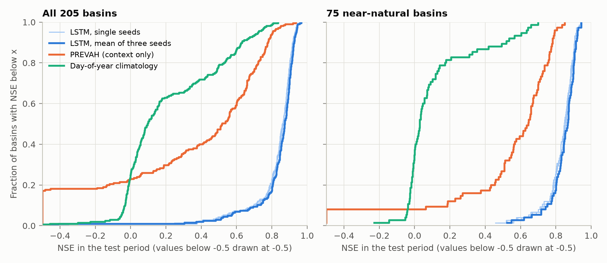
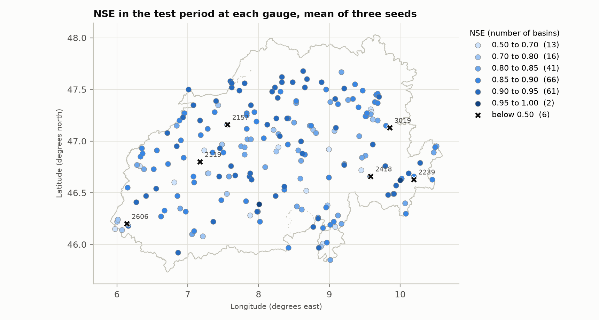
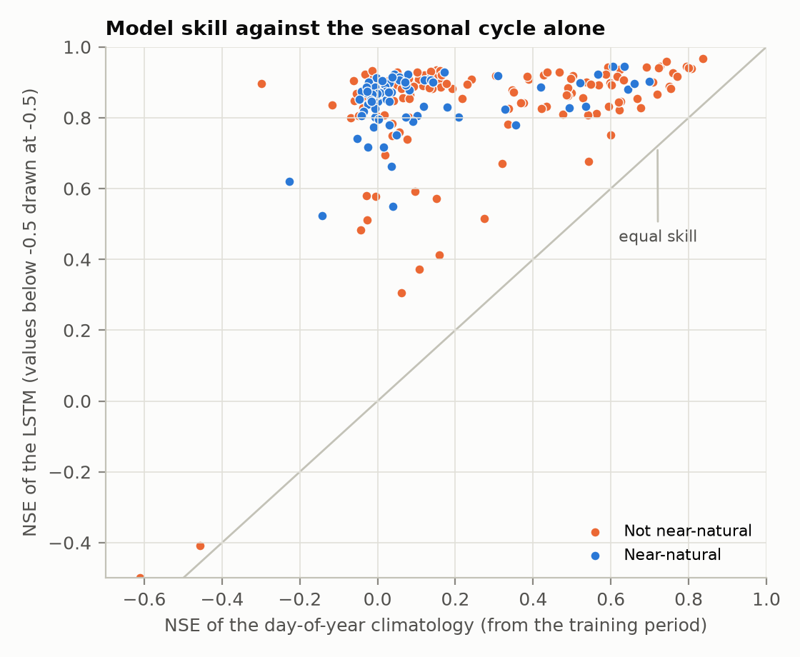
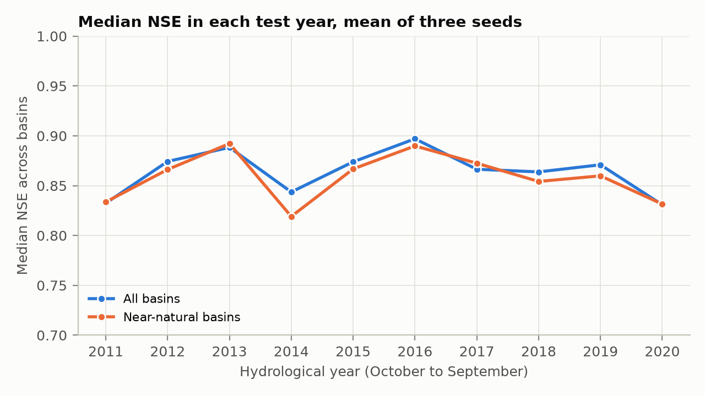

# Results

Generated by `scripts/make_report.py` from `results/verification/` and `results/audit/`. Do not edit by hand.

Only setting 1 has been run and verified so far. Settings 2 (ungauged basins), 3 (data-scarce transfer) and the
gradient-boosting comparison are not done.

### Setting 1. Unseen period in gauged basins

One model is trained on all 205 basins with data from 1981-10-01 to 2005-09-30 and evaluated in the same
basins from 2010-10-01 to 2020-09-30. Three seeds, 30 epochs each, no early stopping, no hyperparameter search.
The last epoch is evaluated once on the test period. Metrics are computed per basin with simulated values below zero set
to zero, and then summarised across basins.

**All 205 basins**

| Model | Median NSE | NSE 5th-95th pct | Basins NSE < 0 | Median KGE | Median log-NSE | Median bias (%) | Median FHV (%) | Median FLV (%) |
|---|---:|---:|---:|---:|---:|---:|---:|---:|
| Seed 1 | 0.864 | 0.53 to 0.93 | 2 | 0.863 | 0.876 | -5.0 | -9.2 | -10.6 |
| Seed 2 | 0.860 | 0.55 to 0.93 | 2 | 0.849 | 0.876 | -6.1 | -10.7 | -9.0 |
| Seed 3 | 0.862 | 0.54 to 0.93 | 2 | 0.848 | 0.875 | -5.3 | -9.6 | +6.3 |
| Mean of the three seeds | 0.873 | 0.57 to 0.94 | 2 | 0.849 | 0.891 | -5.3 | -10.1 | +15.5 |
| Day-of-year climatology | 0.097 | -0.05 to 0.72 | 50 | 0.161 | 0.011 | +5.2 | n/a | n/a |
| PREVAH (context only) | 0.519 | -5.05 to 0.81 | 47 | 0.597 | 0.593 | +3.9 | n/a | n/a |

**75 near-natural basins** (no regulation, reservoir, glacier, lake, open water balance or unknown human influence flag)

| Model | Median NSE | NSE 5th-95th pct | Basins NSE < 0 | Median KGE | Median log-NSE | Median bias (%) | Median FHV (%) | Median FLV (%) |
|---|---:|---:|---:|---:|---:|---:|---:|---:|
| Seed 1 | 0.857 | 0.66 to 0.91 | 0 | 0.817 | 0.889 | -7.3 | -13.2 | -27.6 |
| Seed 2 | 0.848 | 0.65 to 0.92 | 0 | 0.825 | 0.879 | -7.2 | -12.3 | -35.0 |
| Seed 3 | 0.854 | 0.68 to 0.91 | 0 | 0.815 | 0.890 | -7.9 | -13.8 | -6.5 |
| Mean of the three seeds | 0.868 | 0.70 to 0.92 | 0 | 0.818 | 0.901 | -7.5 | -13.4 | +4.1 |
| Day-of-year climatology | 0.030 | -0.04 to 0.61 | 26 | 0.000 | -0.160 | +7.0 | n/a | n/a |
| PREVAH (context only) | 0.645 | -1.09 to 0.79 | 6 | 0.621 | 0.724 | -0.3 | n/a | n/a |

NSE and KGE are 1 for a perfect simulation. FHV is the bias of the highest 2 % of flows and FLV the bias of the lowest
30 % in log space (Yilmaz et al., 2008). The climatology is the mean observed flow of each calendar day in the training
period. PREVAH is the calibrated process-based simulation shipped with CAMELS-CH. Its calibration may have used the
test period and its forcing changes on 2010-01-01, so it is shown for context and not as a competitor.

**What the numbers say**

- A single model reaches a median NSE of 0.86 (seeds from 0.860 to 0.864). Averaging the three
  simulations gives 0.873. The first number describes one model and the second an ensemble of three.
- The near-natural subset has a median of 0.868, the remaining basins 0.883. Human influence does not
  lower the median, but it accounts for every poor basin. All 6 basins with NSE below 0.5 are regulated or
  have an open water balance, and the lowest NSE among near-natural basins is 0.52.
- 2 basins have a negative NSE. Both are described under failures below.
- High flows are underestimated. The median FHV is -10 % for all basins and -13 % for near-natural
  basins, and the simulated variability is 0.89 of the observed one in the median basin.
- Total volume is underestimated by a median of 5.3 % (7.5 % in near-natural basins).
- Small basins are harder. Basins below 50 km2 have a median NSE of 0.81, basins between 200 and 1000 km2
  0.89.
- FLV is not a usable summary here. Between 20 and 32 basins per seed have observed or simulated
  flows near zero in the low-flow segment, where the log bias takes values of several thousand percent. The median
  log-NSE of 0.891 is the more reliable low-flow number.

**Is the skill only the seasonal cycle?**

Many of these basins are fed by snow and ice and have a regular annual cycle that a model can reproduce without
predicting anything. The table compares the model with the day-of-year climatology of each basin. The skill over
climatology is 1 minus the ratio of the squared errors of the model and of the climatology.

| Group | Basins | Median NSE | 25th pct NSE | Lowest NSE | Median NSE of climatology | Median skill over climatology |
|---|---:|---:|---:|---:|---:|---:|
| All basins | 205 | 0.873 | 0.83 | -1.66 | 0.10 | 0.83 |
| Near-natural | 75 | 0.868 | 0.82 | 0.52 | 0.03 | 0.85 |
| Not near-natural | 130 | 0.883 | 0.83 | -1.66 | 0.16 | 0.81 |
| Regulated | 81 | 0.888 | 0.83 | -0.41 | 0.24 | 0.81 |
| Major reservoir | 48 | 0.855 | 0.79 | -0.41 | 0.36 | 0.72 |
| Lake-influenced | 34 | 0.903 | 0.86 | 0.41 | 0.15 | 0.86 |
| Open water balance | 18 | 0.805 | 0.58 | -1.66 | 0.07 | 0.59 |
| Outside Switzerland (human influence unknown) | 30 | 0.856 | 0.80 | 0.37 | 0.08 | 0.77 |
| No glacier | 105 | 0.863 | 0.81 | -1.66 | 0.03 | 0.86 |
| Glacier cover > 5 % | 32 | 0.900 | 0.84 | 0.41 | 0.65 | 0.69 |
| Glacier cover > 20 % | 10 | 0.885 | 0.85 | 0.68 | 0.75 | 0.57 |
| Snow fraction < 0.1 | 51 | 0.872 | 0.82 | -1.66 | 0.00 | 0.87 |
| Snow fraction > 0.5 | 15 | 0.883 | 0.84 | 0.68 | 0.69 | 0.64 |
| Mean elevation < 700 m | 22 | 0.887 | 0.75 | -1.66 | 0.01 | 0.89 |
| Mean elevation 700-1200 m | 74 | 0.873 | 0.85 | 0.51 | 0.02 | 0.87 |
| Mean elevation 1200-1800 m | 50 | 0.880 | 0.80 | 0.41 | 0.17 | 0.81 |
| Mean elevation 1800-2400 m | 47 | 0.854 | 0.82 | -0.41 | 0.54 | 0.70 |
| Mean elevation > 2400 m | 12 | 0.892 | 0.86 | 0.68 | 0.72 | 0.68 |
| Area < 50 km2 | 40 | 0.807 | 0.75 | -1.66 | 0.02 | 0.75 |
| Area 50-200 km2 | 58 | 0.873 | 0.85 | 0.51 | 0.09 | 0.84 |
| Area 200-1000 km2 | 62 | 0.893 | 0.85 | -0.41 | 0.07 | 0.86 |
| Area > 1000 km2 | 45 | 0.895 | 0.83 | 0.41 | 0.32 | 0.83 |

Across all basins the median skill over climatology is 0.83 and the median NSE of the anomalies from the seasonal
cycle is 0.83. In basins without glacier the climatology has no skill (median NSE 0.03)
and the model NSE of 0.86 is all predictive. In basins with more than 20 % glacier cover the climatology
alone reaches 0.75, and the model improves on it by
0.57 of the remaining error. A high NSE in a glacier basin means
less than the same NSE in a lowland basin.

**Stability over the test years**

| Hydrological year | Basins | Median NSE | Median NSE, basins with all years | Mean NSE | Mean NSE without basin 2239 |
|---:|---:|---:|---:|---:|---:|
| 2011 | 204 | 0.832 | 0.834 | 0.76 | 0.77 |
| 2012 | 203 | 0.874 | 0.875 | 0.82 | 0.82 |
| 2013 | 204 | 0.888 | 0.889 | 0.84 | 0.84 |
| 2014 | 205 | 0.844 | 0.851 | 0.79 | 0.79 |
| 2015 | 204 | 0.874 | 0.878 | 0.83 | 0.83 |
| 2016 | 204 | 0.897 | 0.903 | 0.86 | 0.87 |
| 2017 | 197 | 0.866 | 0.874 | -0.40 | 0.80 |
| 2018 | 188 | 0.864 | 0.863 | -2.53 | 0.81 |
| 2019 | 171 | 0.871 | 0.871 | -5.26 | 0.81 |
| 2020 | 172 | 0.831 | 0.830 | -2.30 | 0.73 |

The median stays between 0.83 and 0.90. The mean is not usable. Basin 2239 has an almost
constant observed flow from 2017 on, which gives yearly NSE values between -1038 and
-234 and pulls the mean of all basins below zero. 33 records, most of them outside Switzerland,
end before the test period does. Restricting the table to the 171 basins with all years changes the yearly
median by at most 0.008.

**Failures**

| Basin | Gauge | River | Area (km2) | Flags | NSE | r | Variability ratio | Mean ratio | Q/P train | Q/P test |
|---:|---|---|---:|---|---:|---:|---:|---:|---:|---:|
| 2157 | Gerlafingen | Strackbach | 13 | water balance open | -1.66 | 0.47 | 0.84 | 0.79 | 1.42 | 1.79 |
| 2239 | Punt dal Gall | Spöl | 295 | regulated, reservoir major, water balance open | -0.41 | 0.45 | 1.10 | 1.26 | 0.11 | 0.10 |
| 2418 | Tiefencastel | Julia | 325 | regulated, reservoir major, water balance open | 0.31 | 0.65 | 0.33 | 0.56 | 0.09 | 0.10 |
| 3019 | Loruens-Aeule | Ill | 536 | water balance open, human info missing | 0.37 | 0.66 | 0.44 | 0.85 | 0.24 | 0.25 |
| 2606 | Genève-Halle de l'ìle | Rhône | 8002 | regulated, reservoir major, glacier, lake | 0.41 | 0.65 | 0.75 | 1.04 | 0.80 | 0.77 |
| 2119 | Fribourg | Sarine | 1271 | regulated, reservoir major | 0.48 | 0.70 | 0.78 | 1.01 | 0.71 | 0.66 |

The variability ratio is the standard deviation of the simulation over that of the observation, the mean ratio is the
same for the mean, and Q/P is discharge over precipitation.

- 2157 (Gerlafingen). Discharge exceeds precipitation in the training period and more so in
  the test period, so the catchment receives water that the forcing does not contain. With the bias removed the NSE
  would be 0.08. The share of days that repeat the previous value falls from
  0.43 to 0.04,
  which points to a change in how the record was produced.
- 2239 (Punt dal Gall). Below a reservoir. The yearly standard deviation of the
  observed flow drops from 0.18 to 0.009 mm/d in 2017. The model cannot
  know about a change in dam operation.
- The other four are regulated rivers or have a Q/P far from a closed water balance. The model reproduces the mean and
  a fraction of the variability, and the timing of releases is not predictable from weather.

**How this compares**

- Lees et al. (2021), LSTM, 669 catchments of CAMELS-GB, gauged basins, split in time. Median NSE 0.88. This is the same kind of experiment and the closest reference.
- Kraft et al. (2025), LSTM, 98 Swiss catchments with little human influence, cross-validation in space and time. Median NSE 0.76, and 0.72 for PREVAH in the same study.
  That experiment predicts basins the model has not seen, which is setting 2 of this project and not this one.
- Values reported for CAMELS-US (Kratzert et al., 2019) are lower. That dataset includes arid basins, where NSE is
  low for every model. CAMELS-CH has none.

### Limitations

- The result holds for gauged basins. It says nothing yet about ungauged basins.
- 130 of 205 basins carry at least one flag for human influence, glacier, lake or open water balance.
  Outside Switzerland the dataset has no information on hydropower, so those 30 basins are flagged as unknown.
- The highest flows are underestimated (median FHV -10 %). For flood forecasting this is the number that matters
  most, and NSE does not show it.
- Hyperparameters are those of Kratzert et al. (2019) and were not tuned. Validation data were not used for any choice.
- The test period has now been looked at. Any later change to this model that is judged on the same ten years is no
  longer a clean test.
- The forcing is a gridded observation product. The test period is 1.0 degrees warmer than the
  training period and has 5 % less precipitation, so the test includes a moderate shift in climate.
- One seed produced a single simulated value of -37.0 mm/d in basin 6007 on 2019-03-28, while
  the other two seeds gave 1.5 and 2.2 mm/d. Setting negative values to zero hides it. The cause is not diagnosed.

### References

- Lees, T., et al. (2021). Benchmarking data-driven rainfall-runoff models in Great Britain. Hydrology and Earth System Sciences 25, 5517. https://doi.org/10.5194/hess-25-5517-2021
- Kraft, B., et al. (2025). CH-RUN: a deep-learning-based spatially contiguous runoff reconstruction for Switzerland. Hydrology and Earth System Sciences 29, 1061. https://doi.org/10.5194/hess-29-1061-2025
- Kratzert, F., et al. (2019). Towards learning universal, regional, and local hydrological behaviors via machine learning applied to large-sample datasets. Hydrology and Earth System Sciences 23, 5089. https://doi.org/10.5194/hess-23-5089-2019
- Yilmaz, K. K., Gupta, H. V., Wagener, T. (2008). A process-based diagnostic approach to model evaluation. Water Resources Research 44, W09417.

### Files

- `results/verification/per_basin_metrics.csv` has every metric for every basin and seed.
- `results/verification/verification_report.json` lists every check with its outcome.
- `results/audit/` has the tables behind the audit.
- `results/tables/` has the tables of this page as CSV.
